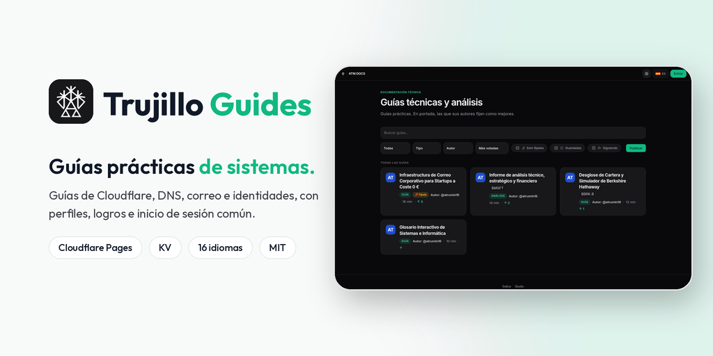
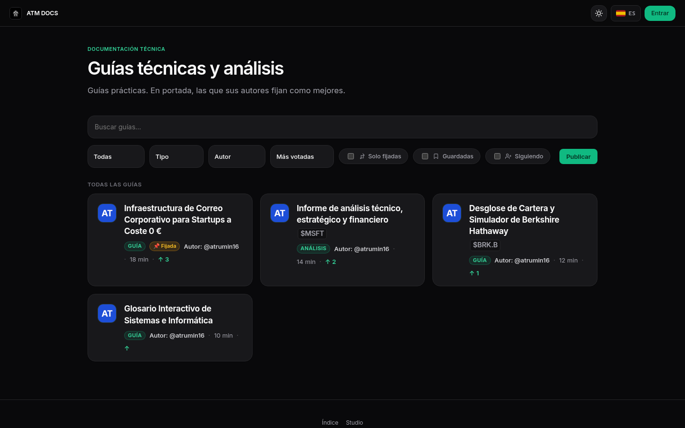
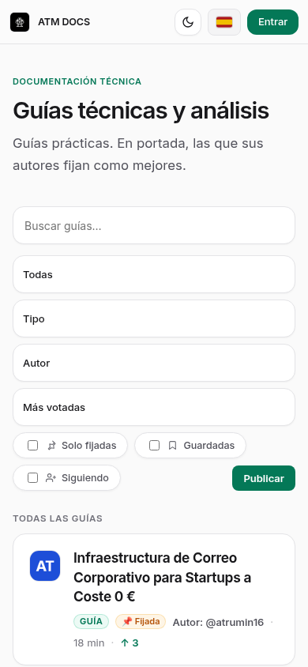
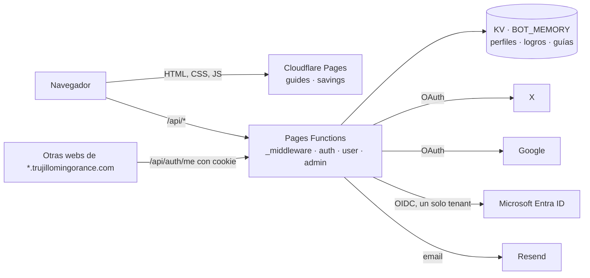

<p align="center">
  
</p>

<p align="center">
  <strong>Guías prácticas de Cloudflare, DNS, correo e identidades, con perfiles de autor, logros e inicio de sesión común.</strong><br/>
  <em>Practical sysadmin guides (Cloudflare, DNS, email, identity) with author profiles and achievements. UI in 16 languages.</em>
</p>

<p align="center">
  <a href="https://guides.trujillomingorance.com"><b>guides.trujillomingorance.com</b></a> ·
  <a href="https://savings.trujillomingorance.com">savings.trujillomingorance.com</a> ·
  <a href="LICENSE">Licencia MIT</a>
</p>

<p align="center">
  
  
  
  
</p>

---

## Capturas

| Escritorio | Móvil |
|:-:|:-:|
|  |  |

## Funciones

- **Guías publicadas:** correo corporativo a coste cero (DNS, SPF, DKIM, DMARC, Cloudflare Email Routing y Resend), glosario interactivo de sistemas con modo test y dos análisis con simuladores. Cada guía tiene su URL `/g/<slug>`.
- **Portada** con búsqueda, filtros por tipo y autor, orden y guías fijadas.
- **Inicio de sesión común** para todas las webs de `*.trujillomingorance.com`: X (OAuth 2.0 con PKCE), Google, y correo con contraseña (registro, verificación y recuperación por email con Resend).
- **Perfiles públicos** en `/u/@usuario` y página `/perfil`: avatar propio (se recorta y reduce en el navegador y se guarda en el servidor), bio, guías y logros.
- **25 logros** con su explicación de cómo desbloquearlos y avisos discretos.
- **Editor de guías** (`/write`) y **ajustes** (`/settings`).
- **16 idiomas** en toda la interfaz, con soporte de derecha a izquierda para el árabe y banderas SVG propias.
- **Panel interno** (`/admin`) solo para cuentas de Microsoft Entra ID del tenant de ATM: estadísticas, usuarios, guías (fijar u ocultar), logros y pestaña **Sitios** con el estado de los subdominios. Los cambios de administración solo los puede hacer la cuenta administradora.
- **Savings & Runway** (`savings.trujillomingorance.com`): calculadora familiar de ahorro, colchón de emergencia y coste de oportunidad, en React. Los datos se procesan en el navegador. Se sirve desde este mismo proyecto.

## Stack

| Capa | Tecnología |
|---|---|
| Frontend | HTML, CSS (`css/nutri.css`, zinc y menta) y JavaScript sin framework. Fuente Outfit autoalojada |
| Savings | Vite + React + TypeScript (`src/`, se compila a `public/savings/`) |
| Hosting | **Cloudflare Pages** (dos dominios: guides y savings) |
| API | **Pages Functions** (`functions/`) |
| Datos | **Workers KV** (`BOT_MEMORY`, compartido con otras webs del dominio) |
| Identidad | JWT HMAC-SHA256 en cookie de `.trujillomingorance.com` · X · Google · Microsoft Entra ID |
| Email | **Resend** (verificación y recuperación de contraseña) |

## Arquitectura



| Ruta | Qué hace |
|---|---|
| `/api/auth/x`, `/google`, `/microsoft` (+ `/callback`) | Inicio de sesión con cada proveedor |
| `/api/auth/login`, `/register`, `/verify-email`, `/forgot-password`, `/reset-password` | Cuenta con correo |
| `/api/auth/me`, `/logout`, `/providers` | Sesión actual (CORS con credenciales solo para `*.trujillomingorance.com`) |
| `/api/user/profile`, `/achievements`, `/stats` | Perfil, logros y estadísticas del usuario |
| `/api/admin/me`, `/stats`, `/users`, `/content`, `/sites` | Panel interno (sesión interna verificada en servidor) |
| `/api/moderation` | Moderación de contenido |

## Seguridad

- **Sesiones:** JWT firmado con HMAC-SHA256 en cookies `HttpOnly; Secure; SameSite=Lax` del dominio `.trujillomingorance.com`. Sin firma válida no hay sesión.
- **OAuth:** `state` en cookie de 10 minutos y PKCE en X. Microsoft solo acepta cuentas del tenant configurado y el rol de administrador se comprueba en el servidor.
- **Respuestas privadas** (`/api/auth/*`, `/api/user/*`, ajustes, editor) con `Cache-Control: no-store` y `Vary: Cookie`.
- **Cabeceras:** HSTS con preload, `nosniff`, Referrer-Policy y Permissions-Policy. `robots.txt` excluye `/api/`, `/settings`, `/write` y `/admin`.
- **Estáticos sin Functions:** `_routes.json` excluye CSS, JS, imágenes, fuentes y datos.

## Desarrollo local

Requisitos: **Node.js ≥ 20**.

```bash
git clone https://github.com/ATM-Software-Labs/trujillo-guides.git && cd trujillo-guides
npm install
npm run build                          # compila Savings en public/savings/
npx wrangler pages dev public          # http://localhost:8788
node --test tests/                     # pruebas de sesión y del panel interno
```

| Comando | Qué hace |
|---|---|
| `npm run build` | Compila la app de Savings con Vite |
| `node --test tests/` | Pruebas de autenticación y Entra ID |
| `npm run deploy` | Build + `wrangler pages deploy public --project-name trujillo-guides` |

## Despliegue

El proyecto de Cloudflare Pages `trujillo-guides` está conectado a GitHub: cada push a `main` publica en `guides.trujillomingorance.com` y `savings.trujillomingorance.com`.

### Variables y bindings (solo nombres)

| Nombre | Tipo | Uso |
|---|---|---|
| `BOT_MEMORY` | binding KV | Perfiles, logros, guías y sesiones auxiliares |
| `JWT_SECRET` | secreto | Firma de sesión (el mismo en las webs que comparten sesión) |
| `X_CLIENT_ID`, `X_CLIENT_SECRET` | variable / secreto | OAuth de X |
| `GOOGLE_CLIENT_ID`, `GOOGLE_CLIENT_SECRET` | variable / secreto | OAuth de Google |
| `MS_TENANT_ID`, `MS_CLIENT_ID`, `MS_CLIENT_SECRET` | variables / secreto | Microsoft Entra ID (un solo tenant) |
| `MS_ADMIN_EMAILS` | variable | Cuentas con permisos de administración |
| `RESEND_API_KEY` | secreto | Correos de verificación y recuperación |

## Estructura

```
public/              páginas (index, g, u, settings, write, admin, achievements), css/, js/, data/, fonts/, savings/
functions/           _middleware.js, perfil.js, api/auth/, api/user/, api/admin/, api/moderation.js, lib/
src/                 app de Savings (React + TypeScript)
tests/               pruebas con node --test
_functions_disabled/ funciones antiguas de la comunidad, desactivadas
docs/                banner, capturas y notas
```

## Licencia

[MIT](LICENSE) © 2026 Alberto Trujillo Mingorance. Fuente Outfit bajo SIL OFL 1.1.

<p align="center"><sub>© 2026 ATM Software Labs · <a href="https://trujillomingorance.com">trujillomingorance.com</a></sub></p>
